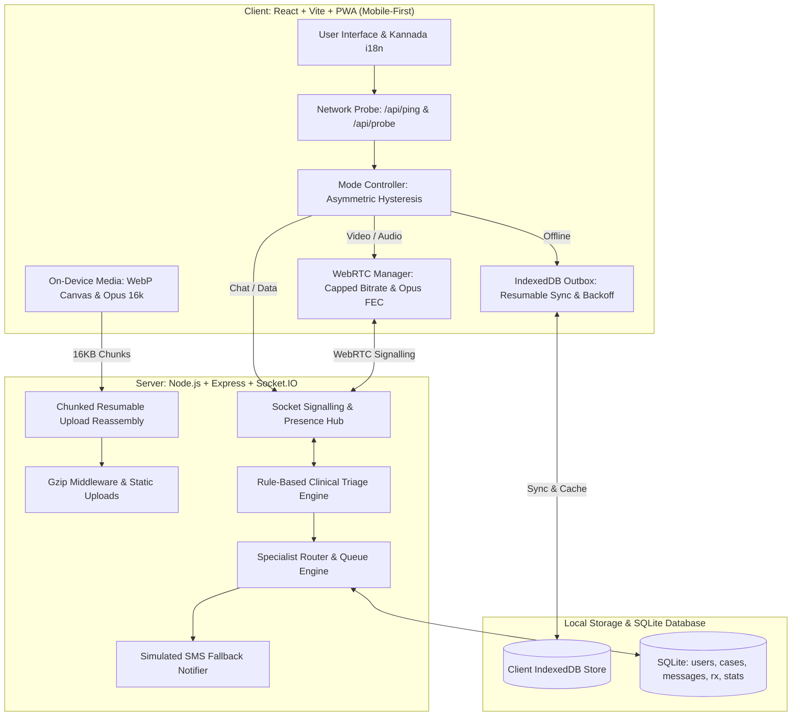

# 🏥 SwasthaSetu (ಸ್ವಾಸ್ಥ್ಯಸೇತು)
### Low-Bandwidth Telemedicine Prototype for Coastal & Hill Talukas
> **Hackathon Problem Statement PS 3.2**: Lightweight Telemedicine Prototype for Low-Bandwidth Coastal & Hill Talukas. Built for uninterrupted rural consultations with continuous network telemetry, explainable rule-based clinical triage, emergency hospital alerts, and offline-first IndexedDB synchronization.

---

## 🌟 Key Innovations

1. **A Consultation Never Dies (Graceful Degradation)**:
   - **Video Mode** (>400 kbps, RTT <400 ms): Capped 480x360 @ 15fps WebRTC video + audio.
   - **Audio Mode** (64 - 400 kbps): Camera automatically shut down, voice prioritized via 16-24 kbps Opus with Forward Error Correction (FEC).
   - **Interactive Chat** (10 - 64 kbps): Real-time WebSockets text and on-device compressed WebP images.
   - **Store-and-Forward Outbox** (<10 kbps or Offline): Everything is encrypted & saved locally to IndexedDB and automatically synchronized once connectivity is restored.
2. **Asymmetric Hysteresis State Machine**:
   - **Zero-delay Downgrade**: Drops mode immediately upon packet loss or latency spike to prevent call drops.
   - **10-Second Upgrade Gate**: Requires network quality to remain stable for at least 10 seconds before upgrading, preventing rapid flapping on erratic cellular towers.
3. **Explainable Clinical Triage (Deterministic, NOT AI)**:
   - Transparent rule-based assessment mapping symptoms to Emergency, Urgent, or Routine priorities.
   - Generates plain-language reasoning (e.g. *"Chest pain reported, immediate cardiac evaluation required"*).
   - Emergency banner with one-tap **108 Ambulance Call** alert.
4. **Specialist Routing & Urgency Queue**:
   - Automatically matches cases to Cardiology, Dermatology, Paediatrics, Gynaecology, Orthopaedics, or General Medicine.
   - Routes to the available specialist with the shortest queue, breaking ties by longest idle time.
   - Doctor dashboard with pulsing emergency alerts and live WebSocket queue updates.
5. **Interactive Network Simulator (`Shift+N`)**:
   - Built-in live network drawer allowing judges to simulate **4G**, **3G**, **2G (Ghat Pass)**, **Very Poor (Hill Valley)**, and **Offline** environments in real time.
6. **Bilingual Support**:
   - Complete Kannada (ಕನ್ನಡ) and English translation toggle.
7. **Simulated Cellular SMS Outbox**:
   - Transparent outbox demonstrating cellular fallback for rural zones with zero mobile data.

---

## 🏗️ Architecture Diagram



---

## ⚡ Quick Start (One Command, Zero External API Keys)

### Requirements
- **Node.js**: v18+ or v22+
- **npm**: v9+

### 1. Install & Seed
```bash
# Clone or open the repository folder
cd sayadhri_2026

# Install dependencies (root and client)
npm install
npm run seed
```

### 2. Run Development Server
```bash
npm run dev
```
Both servers will start concurrently:
- **Client (PWA Web App)**: [http://localhost:5173](http://localhost:5173)
- **Server (Express & Sockets)**: [http://localhost:5000](http://localhost:5000)

### 3. Run Automated Tests
```bash
npm test
```
Executes all 28 automated tests covering triage rules, specialist router, asymmetric hysteresis mode controller, and outbox exponential backoff.

---

## 👥 Seeded Demo Accounts (One-Tap Login)

The login screen includes quick-fill buttons for instant demo access:

| Role | Name | Taluka / Facility | Key Specialty |
|---|---|---|---|
| **Patient** | Ramesh Gowda | Gokarna Coastal Hamlet, Kumta | General / Cardiac Demo |
| **Patient** | Gowramma Hegde | Bilgi Village, Siddapur | Dermatology Demo |
| **ASHA Worker** | Sunitha Hegde | Sirsi Taluka Rural Wing | Multi-patient assisted triage |
| **Doctor** | Dr. Ananya Bhat | Karwar District Hospital | Cardiology |
| **Doctor** | Dr. Kiran Rao | Chikkamagaluru Hill Center | Paediatrics |
| **Doctor** | Dr. Priya Kamath | Udupi PHC | Dermatology |
| **Doctor** | Dr. Shruthi Naik | Kumta Taluka Hospital | Gynaecology |
| **Doctor** | Dr. Rajesh Shettigar | Honnavar Coastal Health | Orthopaedics |
| **Doctor** | Dr. Mohammed Irfan | Sirsi Taluka Center | General Medicine |

---

## 📡 Bandwidth Optimisation Techniques (Hackathon Deliverable)

SwasthaSetu achieves up to **90% bandwidth savings** over conventional telemedicine systems:

1. **Adaptive Mode Switching with Asymmetric Hysteresis**:
   - Measures round-trip time (`/api/ping`) and throughput (`/api/probe`) continuously every 3 seconds.
   - When the signal drops, the mode downgrades in **0 ms** (instant transition).
   - When the signal improves, an upgrade requires **10 seconds** of sustained high quality, eliminating jitter and flapping on coastal cellular borders.
2. **Bandwidth-Capped WebRTC Video**:
   - Caps video resolution to **480x360** at **15 frames per second**.
   - Applies sender bandwidth shaping via `RTCRtpSender.setParameters({ maxBitrate: 250000 })` to enforce a 250 kbps ceiling.
3. **Low-Bitrate Opus Audio with In-Band FEC**:
   - Audio tracks are shaped via SDP modification (`maxaveragebitrate=20000;useinbandfec=1;cbr=1`).
   - Limits audio consumption to 16-24 kbps while enabling forward error correction against packet loss.
4. **On-Device Canvas Image Compression**:
   - Photos taken on 12-48 MP mobile cameras (often 3-8 MB) are downscaled entirely in the browser canvas to a maximum of 1024px.
   - Encoded as **WebP at 0.6 quality**, shrinking payload sizes to **under 100 KB** (displaying *"Original 3.2 MB, Sent 78 KB"*).
5. **16 KB Chunked Resumable Uploads**:
   - Attachments are sliced into sequential 16 KB chunks with an `uploadId`.
   - If connectivity collapses mid-upload, the client resumes exactly from the last acknowledged chunk without retransmitting previous data.
6. **Offline-First Outbox with Exponential Backoff**:
   - When offline or under 10 kbps, consultations, chat messages, and prescriptions are written to IndexedDB.
   - The sync worker automatically retries on reconnection with exponential backoff (`delay = base * 2^attempt`) and idempotent client-generated UUIDs.
7. **Gzip Server Middleware & Compact JSON**:
   - Node.js `compression()` middleware compresses all HTTP responses.
8. **Cached PWA App Shell**:
   - Web App Manifest and Service Worker (`sw.js`) cache the HTML, CSS, icons, and JavaScript shell so the application boots instantly without active internet.

---

## 🔌 API & Realtime Socket Contract

### REST Endpoints
- `POST /api/auth/login`: Issue JWT token and profile.
- `GET /api/auth/demo-users`: List demo accounts for quick-fill.
- `GET /api/ping`: Ultra-lightweight RTT probe response (`{ pong: 1 }`).
- `GET /api/probe`: 32 KB binary buffer for download throughput timing.
- `POST /api/triage`: Evaluates questionnaire and returns urgency, reasons, and specialty.
- `POST /api/cases`: Idempotent case creation and queue routing.
- `GET /api/cases`: Fetch cases filtered by patient, ASHA worker, or doctor.
- `GET /api/cases/:id`: Detailed case view with messages and prescription.
- `POST /api/cases/:id/messages`: Idempotent consultation chat dispatch.
- `POST /api/uploads/init`: Initialize chunked upload session.
- `POST /api/uploads/:uploadId/chunks`: Upload an individual 16 KB slice.
- `POST /api/uploads/:uploadId/complete`: Assemble chunks on server and return URL.
- `POST /api/cases/:id/advice`: Doctor submits prescription and advice note.
- `GET /api/doctors`: Doctor directory with specialties and current queue lengths.
- `GET /api/notifications`: Simulated cellular SMS transmissions.
- `GET /api/stats`: Impact analytics (consultations per mode, bandwidth saved).

### Socket.IO Events
- `join-case`: Join consultation room and update doctor/patient presence.
- `message`: Real-time chat message delivery.
- `mode-change`: Broadcasts degradation transitions (Video <-> Audio <-> Chat).
- `webrtc-offer` / `webrtc-answer` / `webrtc-ice`: WebRTC peer signalling.
- `queue-update`: Notifies doctor workstations of incoming triage priority changes.

---

## ⚖️ Disclaimer
*SwasthaSetu is a technology prototype built for demonstration and evaluation in hackathon problem statements. It is not certified as a diagnostic medical device.*
